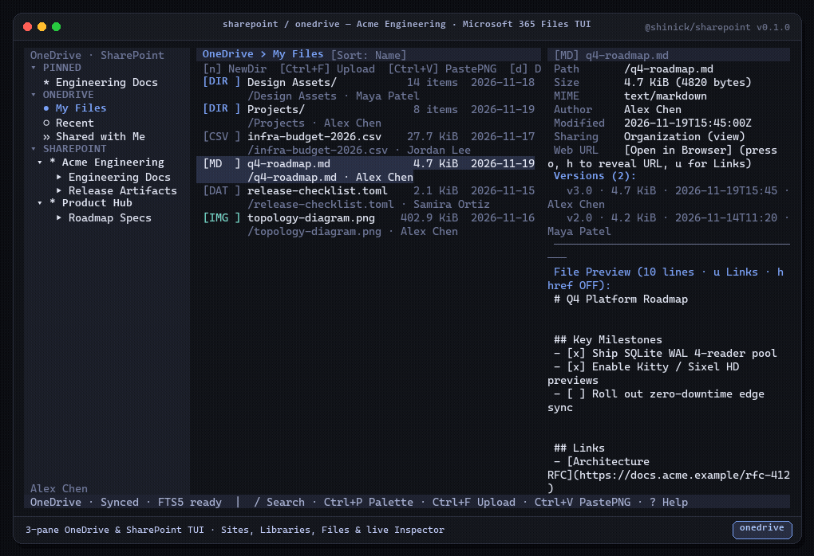

<div align="center">

# `@shinick/sharepoint`

**Unified Microsoft SharePoint & OneDrive terminal client, CLI, HTTP API, and MCP server — powered by Rust, Ratatui, and local SQLite FTS5.**

[](https://www.npmjs.com/package/@shinick/sharepoint)
[](docs/NPM.md)
[](Cargo.toml)
[](package.json)

<br />



</div>

---

## Highlights

| Capability | Details |
| --- | --- |
| **Minimal-Chrome 3-Pane TUI** | Dual-persona explorer (`sharepoint`/`sp` & `onedrive`/`od`) with collapsible Sites, Document Libraries & OneDrive sidebar, sorted file list, live Inspector (metadata, version history, Markdown/YAML/JSON/code preview), Link Extractor (`u`), File Picker with `zoxide` (`Ctrl+F`), Context Menu (`.`), and 6 themes. |
| **High-Res Terminal Images** | Inline Inspector thumbnails & fullscreen HD previews (`v` / `Alt+v`) with 80ms protocol probing for **Kitty**, **iTerm2**, **Sixel** (Floyd-Steinberg dithering), and **24-bit Unicode Half-Blocks** + `Ctrl+V` instant clipboard PNG upload. |
| **Local SQLite FTS5 + IPC Daemon** | WAL-mode SQLite cache with 4-reader pool, hybrid local FTS5 + remote Graph search (`/`), streaming chunked uploads (`> 4 MiB`), and a shared background sync daemon (`sharepoint daemon start`). |
| **4-in-1 Agent Interface** | Interactive **TUI**, scriptable `--json` **CLI**, local **HTTP JSON API** (`sharepoint serve`, port `8790`), and stdio **MCP Server** (`sharepoint mcp`, 16 tools). |

---

## Quick Start

```sh
# 1. Install globally via npm (precompiled native binary for win32 / darwin / linux)
npm i -g @shinick/sharepoint

# 2. Authenticate with Microsoft 365 (PKCE loopback, --device-code, or shared M365 token)
sharepoint login

# 3. Launch the interactive 3-pane TUI in either persona
sharepoint          # SharePoint Sites & Document Libraries (alias: sp)
onedrive            # Personal OneDrive: My Files, Recent, Shared (alias: od)
```

> Required Microsoft Graph delegated scopes: `Files.ReadWrite.All`, `Sites.ReadWrite.All`, `User.Read`, `offline_access`.  
> Prefer building from source? Run `cargo build --release` and see [docs/NPM.md](docs/NPM.md) for external token brokers & environment variables.

---

## Keybindings Cheat Sheet

| Key | Action |
| --- | --- |
| `Tab` / `Shift+Tab` | Cycle focus (Sidebar → File List → Inspector) |
| `j` / `k` · `↑` / `↓` | Move selection / scroll Inspector preview |
| `Enter` / `Backspace` | Open folder or site / navigate to parent folder |
| `S` | Cycle sort order (Name / Modified / Size / Type) |
| `Ctrl+F` | Upload file via interactive File Picker (`z` for `zoxide` jump) |
| `Ctrl+V` | Encode clipboard image as PNG & upload to current folder |
| `d` / `n` / `r` / `x` | Download file / new folder / rename / delete (with confirm) |
| `s` / `o` / `p` | Create & copy share link / open in browser / pin target |
| `v` / `u` / `h` | HD image preview / Link Extractor / toggle inline `href` URLs |
| `/` | Hybrid local FTS5 + Microsoft Graph file search |
| `Ctrl+P` / `Ctrl+K` | Unified Command Palette & Library Omni-Switcher |
| `.` / Right-click | Context Menu |
| `Ctrl+,` / `Ctrl+B` / `?` | Settings / Toggle sidebar / Keyboard shortcuts help |

---

## CLI, HTTP API & MCP

### CLI (`--json` on every command)

```sh
sharepoint sites --json
sharepoint drives --site "Acme Engineering" --json
onedrive ls /Projects/Platform-v4 --json
onedrive cat /Projects/Platform-v4/deploy-pipeline.yaml
sharepoint upload ./q4-architecture-deck.pdf /RFCs --site "Acme Engineering" --json
sharepoint share /api-gateway-rfc.md --site "Acme Engineering" --type view --scope organization --json
sharepoint search "gateway" --remote --json
```

### Local HTTP API (`sharepoint serve`)

```sh
# Start local Axum JSON server (default 127.0.0.1:8790)
sharepoint serve --port 8790 --api-key dev-secret

# Search files across OneDrive & SharePoint from scripts or agents
curl -H "Authorization: Bearer dev-secret" \
  "http://127.0.0.1:8790/v1/search?q=gateway&remote=true&limit=10"
```

Full route reference & OpenAPI 3.1 spec: [docs/API.md](docs/API.md) · [docs/openapi.yaml](docs/openapi.yaml).

### Model Context Protocol (`sharepoint mcp`)

Add to Claude Desktop, Claude Code, Cursor, or Codex (`16` tools over stdio JSON-RPC 2.0):

```json
{
  "mcpServers": {
    "sharepoint": {
      "command": "sharepoint",
      "args": ["mcp"]
    }
  }
}
```

Full tool catalog & schemas: [docs/MCP.md](docs/MCP.md).

---

## `@shinick` Enterprise Terminal Suite

| Package | Commands | Workspace Coverage |
| --- | --- | --- |
| [`@shinick/teams`](https://www.npmjs.com/package/@shinick/teams) | `teams`, `tm` | Microsoft Teams chats, channels, threads & meetings |
| [`@shinick/outlook`](https://www.npmjs.com/package/@shinick/outlook) | `outlook`, `mail`, `cal` | Microsoft Outlook mail, calendar & contacts |
| [`@shinick/onenote`](https://www.npmjs.com/package/@shinick/onenote) | `onenote`, `note` | Microsoft OneNote notebooks, sections, pages & XHTML/Markdown |
| **`@shinick/sharepoint`** | `sharepoint`, `sp`, `onedrive`, `od` | Microsoft SharePoint sites, document libraries & OneDrive files |
| [`@shinick/atlassian`](https://www.npmjs.com/package/@shinick/atlassian) | `atlassian`, `jira`, `confluence` | Atlassian Jira issues, boards, sprints & Confluence pages |
| [`@shinick/notion`](https://www.npmjs.com/package/@shinick/notion) | `notion`, `nt` | Notion pages, databases, blocks & Markdown sync |

---

## License & Disclaimer

Licensed under the **MIT License**.

> Unofficial terminal client for Microsoft SharePoint & OneDrive. Not affiliated with, endorsed by, or sponsored by Microsoft Corporation.
